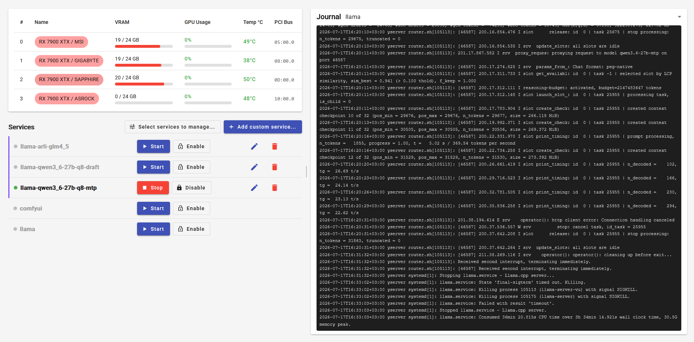
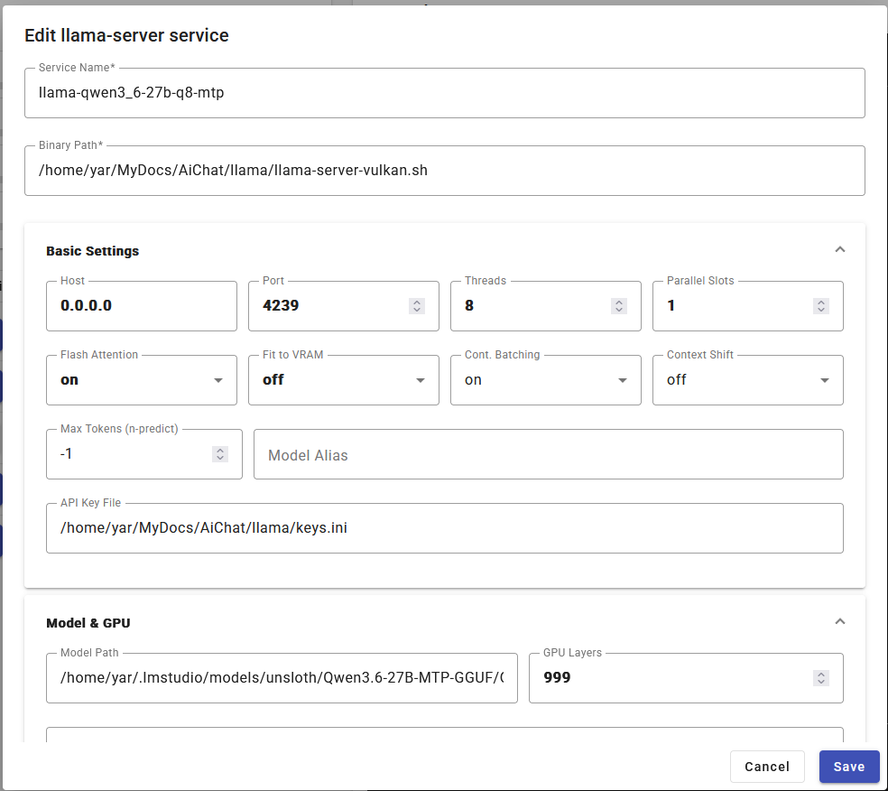
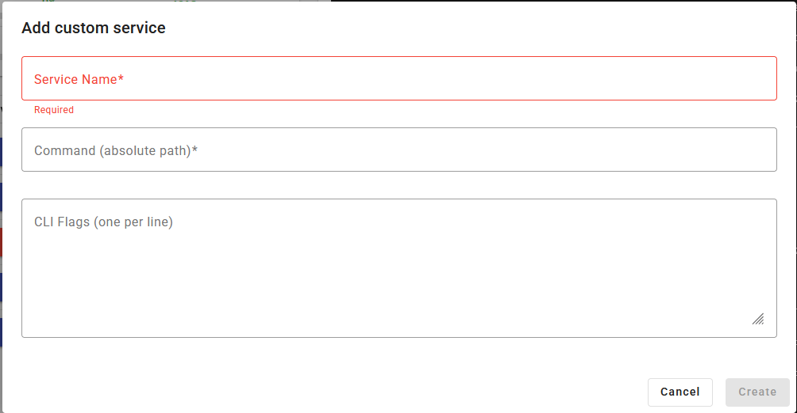

# AI Server Manager

Web dashboard for monitoring GPU server and managing AI services (llama.cpp, ComfyUI, and any other).





## Features

- **GPU Monitoring** — Real-time GPU utilization, temperature, and VRAM usage. Supports NVIDIA, AMD, and Intel GPUs with automatic detection and deduplication.
- **Custom Services** — Create your own service with a custom name, command, CLI flags, and environment variables. Installed as a `systemd` unit on Linux and through the bundled [WinSW](https://github.com/winsw/winsw) host on Windows, so plain programs and `.cmd` launchers (ComfyUI, `llama-server`) work as services.
- **Run as a user** — custom services run as `root` on Linux and `LocalSystem` on Windows unless the config names another account (`unit.user=` = `NAME`, `HOST\NAME` or `NAME@domain`). On Windows the Service Control Manager can only log an account on with its password, so the dashboard asks for it in a small dialog at the moment it is needed — on Install, Reinstall, Save and Restore from archive — and forgets it right after: it is **never stored on disk** (the manager keeps its own protected copy) and there is no password field in the service settings. Cancelling the prompt cancels the action. Install also gives the account the **"Log on as a service"** right, which registering a service does not: without it every start fails with error 1069. Both steps need an elevated backend. Without an account the program sees a different `%USERPROFILE%`/`%APPDATA%` and none of your credentials (private git repos, caches, config files). Changing the account's password takes a **Reinstall** with the new one.
- **Groups are a Linux thing** — `unit.group=` maps to systemd `Group=` and has no Windows counterpart, so the group field is disabled when the backend runs Windows (its value survives the save). The wording of the run-as fields follows the backend too: `empty → root` on Linux, `empty → LocalSystem` on Windows.
- **No silent root** — `HOST\NAME`, `.\NAME` and `NAME@domain` name a Windows account; systemd only understands a bare name in `User=`. On Linux such a value used to be dropped from the unit and the program started **as root**; now the install is refused and the dashboard says so (write the bare name, or leave the field empty if root is what you want). The user field shows the `HOST\user` form only when the backend runs Windows.
- **Stop command** — `unit.stop=` overrides how a service is stopped (`ExecStop=` on Linux, `<stopexecutable>`/`<stoparguments>` on Windows). Use it when the program ignores the OS stop signal. Batch launchers need nothing here: `cmd.exe` answers the stop signal with "Terminate batch job (Y/N)?", which nothing can answer in a service, so a `.cmd`/`.bat` service is given a short (5 s) stop window and its process tree is then killed instead of waiting out WinSW's 15-second default. On Windows the command is also handed the service's own arguments, and WinSW has no pid placeholder for it — put that logic in a small script of your own if you need it.
- **Managed Services** — Discover and manage any installed system service from the dashboard. Start, stop, enable, or disable with a single click. **Enable** means "starts on boot" (`systemctl enable` / start type `Automatic`); **Disable** only takes that autostart away (`systemctl disable` / start type `Manual`) — the service stays startable by hand. Windows `start= disabled` is deliberately not used: it makes the service unstartable at all (start then fails with 1058 until it is enabled again), which is not what the dashboard button means.
- **Cross-platform** — Runs on Linux (systemctl) and Windows (Windows Services, experimental). Control operations need an elevated backend on Windows and root or passwordless sudo on Linux; the dashboard shows which backend process answers your requests and whether it has those rights.

## Run it as a system service

Running the dashboard in a terminal works for a quick look, but a manager that dies with your SSH session is not much of a manager — and on Windows a backend without admin rights cannot control services at all. The published package registers itself:

```bash
npm install -g aiservermanager
sudo aiservermanager install                    # Linux: /etc/systemd/system/aiservermanager.service
```

```powershell
npm install -g aiservermanager
aiservermanager install                         # Windows: run from an elevated PowerShell
```

```
aiservermanager status
aiservermanager restart
aiservermanager uninstall
```

- `--port <n>` / `--host <iface>` are baked into the unit; the default binding stays `127.0.0.1`, and `--host 0.0.0.0` is what a headless GPU box needs for LAN access (the dashboard logs in with an OS account password, so exposing it is a decision, not a default).
- `--config-home <dir>` picks the home whose `.config/aiservermanager` the service reads. The service runs as **root / LocalSystem** (that is what controlling other services requires) but keeps `HOME`/`USERPROFILE` pointed at the user who installed it, so every custom service config you already created stays visible. Under `sudo` the user behind `SUDO_USER` is used automatically.
- `--auth-user <name>` (`NAME`, `HOST\NAME` or `NAME@domain`) sets **whose password opens the dashboard**, written into the unit as `AUTH_USER`; it defaults to the user running the install. Needed because the service account has no password to type: without an account the login says so instead of calling a correct password wrong, and changing it takes an install with the new name (or `AUTH_USER` in the unit plus a restart).
- The installer refuses to register a service for a port that is already taken — that service would start and immediately exit.
- `uninstall` removes the unit / WinSW wrapper and leaves `~/.config/aiservermanager` alone.

## Architecture

Monorepo with two packages:

| Package      | Stack                                       |
| ------------ | ------------------------------------------- |
| **backend**  | Node.js, Express 5, TypeScript, InversifyJS |
| **frontend** | Angular 22, Angular Material, RxJS, signals |

## Prerequisites

- **Node.js** 24+
- On Linux:
  - `sudo apt install libpam0g-dev` (for PAM bindings)
  - passwordless `sudo` for the dashboard user (the server runs `systemctl`, `journalctl`, `reboot`, `poweroff` etc. via sudo; grant it by running `sudo visudo -f /etc/sudoers.d/aiservermanager` and adding the line `<username> ALL=(root) NOPASSWD: ALL`)

## Quick Start

Run from npm without cloning the repo:

```bash
# Linux need PAM library
sudo apt install libpam0g-dev

# Run from npm without cloning the repo
npx --yes aiservermanager@latest
```

Or run from the source checkout:

```bash
# Install dependencies for all packages
npm run install:all

# Run in development mode (backend + frontend)
npm run dev

# Build for production
npm run build

# Start production server
npm start
```

The server listens on `PORT=4243` and `HOST=127.0.0.1` by default.
Override with environment variables (HOST and PORT).

## GPU Detection Pipeline

**Bootstrap** (runs once):

1. **Detectors** — `nvidia-smi`, `rocm-smi`, WMI (Windows), registry lookups
2. **Deduplication** — by `vendor:pciBusId` (fallback: `vendor:name`), highest-score entry wins
3. **Enrichers** — `lspci` branding
4. **GPU labels** — user-defined text per GPU loaded from `~/.config/aiservermanager/gpu-label.conf`
   (one `pciBusId=text` line per GPU). Edit it directly in the **GPU Label** column of the GPU table —
   no auto-detection of `cuda0`/`rocm0`/`vulkan0` numbers.

**Polling** (every request):

- Usage probes collect dynamic metrics (utilization %, temperature, VRAM used) and merge them with the cached static info by `pciBusId`.

## Release

Published to npm as **`aiservermanager`**. End users run it without cloning or installing:

```bash
npx --yes aiservermanager@latest
```

The release flow is automated by `.github/workflows/publish.yml`:

```bash
npm version patch               # "patch", "minor" or "major"
git push origin master --tags   # push the commit and the tags
```

## License

MIT — see [LICENSE](LICENSE)
